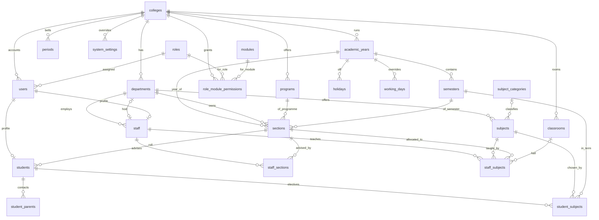

# Dashboard functionality

This document describes the web dashboard only: the Node.js application under `src/`, the worker that marks attendance, and the PostgreSQL tables it reads and writes. Camera recognition (the Python pipeline) is outside this document. It only appears where the dashboard consumes its output: rows in `identity.identification_events` and `identity.unresolved_detections`.

The dashboard is a server-rendered Express application. Every page is also available as JSON under `/api/v1` with the same permissions. Two processes run the product:

- `npm start` serves pages (`src/server.js`).
- `npm run worker` marks attendance from camera events (`src/worker.js`).

Schema source: `db/schema/srm_attendance_whole_schema_v2_3.sql`. Tables live in two schemas, `attendance` and `identity`.

---

## 1. Database tables

### Master tables

Master tables describe the college. They are created during setup and change only when the academic structure, people, or rules change. They are not written once per class or once per camera sighting.

| Table | What it holds |
| --- | --- |
| `attendance.colleges` | One row per college: code, name, campus, timezone, active flag. Every other college-owned row hangs off this. |
| `attendance.roles` | The five role names: superadmin, admin, hod, staff, student. |
| `attendance.modules` | The module catalogue (dashboard, attendance, timetable, and so on). Seeded by migration; not edited in the UI. |
| `attendance.role_module_permissions` | Per college and role: view, edit, delete, export on each module. Written only by the superadmin. |
| `attendance.system_settings` | Thresholds and switches. A row with `college_id` null is the group default; a college row overrides it. |
| `attendance.departments` | Department code, name, and the HOD (`hod_staff_id`). |
| `attendance.programs` | Programme code, name, and duration in years (for example B.E.). |
| `attendance.subject_categories` | Lookup of subject categories. Created when an upload names a category that does not exist yet. |
| `attendance.subjects` | Subject code, name, short name, department, semester, credits, L-T-P hours, lab flag. |
| `attendance.academic_years` | Year label and dates. One year per college is marked `is_active`. |
| `attendance.semesters` | Semester number and date range inside an academic year. |
| `attendance.periods` | Bell times for the college: period number, start, end, duration. Attendance uses these times. |
| `attendance.holidays` | Dates with no classes, typed as government, college, exam, or festival. |
| `attendance.working_days` | Overrides for a single date: classes run, or they do not. |
| `attendance.classrooms` | Room number, block, floor, capacity, and whether the room has a camera. |
| `attendance.sections` | A class: department, programme, academic year, semester, section name, sanctioned strength. |
| `attendance.users` | Sign-in accounts: username, password hash, role, college, department, status, lockout, password-reset token. |
| `attendance.staff` | Staff profile linked 1:1 to a user: staff code, designation, department, employee type, joining date, status. |
| `attendance.staff_sections` | Staff assigned to a section as subject staff, class advisor, or mentor. The dashboard reads this for scope. No screen writes it. |
| `attendance.staff_subjects` | Who teaches which subject to which class this year, and the hall when it is not the class's own room. |
| `identity.students` | Student profile: university id, register number, section, enrolment status, consent, face-registered flag. Optionally linked to a user. |
| `attendance.student_parents` | Father, mother, or guardian name, mobile, and email for a student. |
| `attendance.student_subjects` | Elective choices: which students take a subject in a semester. A subject with no rows here is taken by the whole section. |
| `identity.cameras` | Camera id (the id the recognition pipeline sends), classroom, secret-store key, optional browser live-view URL, enabled flag. |

### Transactional tables

Transactional tables are written while the college operates: sign-ins, uploads, timetable changes, camera events, marks, corrections, alerts, and audit.

| Table | What it holds |
| --- | --- |
| `attendance.user_sessions` | Open sign-ins. The cookie stores a hash of the session token. Idle timeout and logout close the row. |
| `attendance.import_batches` | One uploaded file: type, status (uploaded, validated, committed, failed, cancelled), counts, and a link to the paired batch when a class sheet produces both an allocation and a timetable. |
| `attendance.import_rows` | One parsed row of an upload, with the raw cells, the normalized values, errors, and an "uncertain" flag for doubtful PDF cells. |
| `attendance.timetable` | One weekly slot: section, subject, staff, room, weekday (ISO, Monday = 1), period, and the dates it is in effect. Replacing a week closes old slots; it does not delete them. |
| `attendance.timetable_history` | Who changed a slot, and the old and new staff, subject, and room. |
| `attendance.class_swaps` | A substitution request for one slot on one date: original staff, replacement, pending / approved / rejected. |
| `identity.face_embeddings` | 512-number face vectors for a student, tagged with the model version. Inserting a row sets `identity.students.face_registered` through a trigger. |
| `attendance.registration_sessions` | One enrolment attempt that was accepted: which student, and which user enrolled them. |
| `attendance.registration_images` | The pose (front, left, right) and the file key of each accepted enrolment photo. |
| `identity.identification_events` | One confident recognition: student, camera, confidence, when the frame was captured, model version, track id, and whether the worker has consumed it. Written by the recognition pipeline, not by the web app. |
| `identity.unresolved_detections` | Faces the pipeline could not accept (quality or match), with the reason and scores. |
| `attendance.ingested_events` | The worker's record of each event: the attendance row it produced, or the reason it was ignored. One event is applied at most once. |
| `attendance.class_sessions` | One timetable slot on one date, written when the period closes: scheduled, closed, needs_manual, or cancelled. `staff_id` is the teacher after an approved substitution. |
| `attendance.records` | The register. One row per student, timetable slot, and date. Status is present, late, absent, or excused. Source is ai, manual, or imported. |
| `attendance.corrections` | The reason and the old and new status when someone changes a mark by hand. |
| `attendance.status_history` | Written by a database trigger whenever `attendance.records.status` changes. |
| `attendance.camera_health_logs` | Online or offline samples for a camera. The period-close job uses these to decide whether a room can be auto-marked. |
| `attendance.unknown_reviews` | A person's review of an unresolved detection: reviewed flag and remarks. |
| `attendance.daily_summary` | Counts and percentage for one section on one date. Rebuilt by `attendance.refresh_daily_summary`. |
| `attendance.subject_summary` | A student's totals and percentage in one subject for one semester. Rebuilt by `attendance.refresh_subject_summary`. |
| `attendance.monthly_summary` | Month-level rollup. Present in the schema. This application does not refresh it. |
| `attendance.alerts` | A student below the college defaulter threshold in a subject: below75, below60, or critical. |
| `attendance.notifications` | In-app messages for a user (attendance, leave, announcement, system). |
| `attendance.email_queue` | Outbound mail. Sent when SMTP is configured; otherwise rows stay pending. |
| `attendance.audit_logs` | Who did what, with old and new JSON values, IP address, and college. |
| `attendance.report_exports` | A log line each time someone downloads an Excel or PDF report. |

### Views used by reports and camera screens

| View | Built from |
| --- | --- |
| `attendance.vw_daily_report` | `records` joined to timetable, subject, and section. |
| `attendance.vw_student_attendance` | Student totals per subject, with percentage from `attendance.pct`. |
| `attendance.vw_defaulters` | `vw_student_attendance` filtered below the college threshold. |
| `attendance.vw_camera_dashboard` | Cameras joined to classrooms. |
| `attendance.vw_unknown_reviews` | Unresolved detections left-joined to reviews. |

### Database functions the dashboard depends on

| Function | Role |
| --- | --- |
| `attendance.setting` | College setting, else the group default, else the caller's fallback. |
| `attendance.pct` | Attendance percentage. Excused either counts as attended or is left out of the total, following the college setting. |
| `attendance.takes_subject` | True when the student is listed for the subject, or when nobody in the section is listed (the whole section takes it). |
| `attendance.sessions_between` | Every class that should run between two dates: the timetable version in effect, minus holidays and non-working overrides, with an approved substitution applied. |
| `attendance.refresh_daily_summary` | Rebuilds `daily_summary` for one date. |
| `attendance.refresh_subject_summary` | Rebuilds `subject_summary` for a semester and a set of students. |
| `attendance.refresh_defaulter_alerts` | Deletes alerts that have recovered and upserts the rest into `alerts`. |
| `attendance.log_status_change` | Trigger on `records`: copies a status change into `status_history`. |
| `identity.mark_face_registered` | Trigger on `face_embeddings`: sets `students.face_registered`. |
| `identity.set_student_college` | Trigger: copies the college from the student's section. |
| `identity.set_camera_college` | Trigger: copies the college from the camera's classroom. |
| `attendance.set_allocation_term` | Trigger on `staff_subjects`: copies academic year and semester from the section. |
| `attendance.set_college_from_department` | Trigger: copies `college_id` from the department. |

---

## 2. Relationship diagram

The diagrams show the foreign keys that carry the product. Audit, notification, and "who changed this" links to `users` are omitted so the academic structure stays readable.

### Academic structure and people



### Timetable, cameras, and attendance

```mermaid
erDiagram
  academic_years ||--o{ timetable : year
  semesters ||--o{ timetable : term
  sections ||--o{ timetable : class
  subjects ||--o{ timetable : subject
  staff ||--o{ timetable : teacher
  classrooms ||--o{ timetable : room
  periods ||--o{ timetable : hour

  timetable ||--o{ timetable_history : changes
  timetable ||--o{ class_swaps : substitutions
  staff ||--o{ class_swaps : original
  staff ||--o{ class_swaps : replacement
  timetable ||--o{ class_sessions : on_a_date
  timetable ||--o{ records : slot
  students ||--o{ records : mark
  records ||--o{ corrections : edited
  records ||--o{ status_history : status_trail

  classrooms ||--o{ cameras : mapped
  cameras ||--o{ identification_events : saw
  students ||--o{ identification_events : matched
  identification_events ||--o| ingested_events : consumed
  records |o--o{ ingested_events : produced
  cameras ||--o{ unresolved_detections : missed
  unresolved_detections ||--o| unknown_reviews : reviewed
  cameras ||--o{ camera_health_logs : health

  students ||--o{ face_embeddings : vectors
  students ||--o{ registration_sessions : enrolled
  registration_sessions ||--o{ registration_images : photos

  students ||--o{ subject_summary : percentage
  subjects ||--o{ subject_summary : in_subject
  students ||--o{ alerts : defaulter
  sections ||--o{ daily_summary : day_totals

  users ||--o{ user_sessions : signed_in
  colleges ||--o{ import_batches : uploads
  import_batches ||--o{ import_rows : preview_rows
  import_batches |o--o| import_batches : paired_sheet
```

---

## 3. How every request is handled

Before any feature runs, a request passes the same pipeline.

- The browser sends a session cookie. `src/middlewares/authenticate.js` loads `attendance.user_sessions`, the user, the role, the college, and the staff or student profile. It builds `req.scope`. Models use that scope. They never take the college or department from the URL.
- `src/middlewares/permit.js` checks `attendance.role_module_permissions` for the module and action named on the route.
- `src/middlewares/csrf.js` requires a token on every non-GET request.
- `src/middlewares/respond.js` renders an EJS page or returns JSON when the path starts with `/api/v1`.
- A student who must change a first password is sent to `/password`. A student who must enrol a face is sent to `/enroll`. Nothing else opens until that is done.
- The sidebar in `src/config/menu.js` shows a group only when the role has view permission on its module.

**Code**

- `src/app.js`, `src/server.js`, `src/routes/index.js`
- `src/middlewares/authenticate.js`, `permit.js`, `csrf.js`, `respond.js`, `errors.js`, `upload.js`
- `src/config/env.js`, `db.js`, `modules.js`, `menu.js`
- `src/public/js/app.js` (page swapping and full screen), `src/public/css/app.css`, `src/views/partials/top.ejs`

**Tables**

- `attendance.user_sessions`, `users`, `roles`, `colleges`, `staff`
- `identity.students`
- `attendance.role_module_permissions`, `modules`, `system_settings`

---

## 4. Setup flow

The college is usable for automatic attendance only after the steps in this section exist. The engine cannot mark a student until there is a college, a class, a timetable slot in a room, a camera mapped to that room, and a face vector for the student.

### 4.1 Sign-in, sign-out, and passwords

**What it does**

- The sign-in form asks for a college, a username, and a password. Superadmin uses the group college "Group administration".
- Passwords are checked with Argon2. Failed attempts increment `users.failed_attempts`. After the college limit (default 5) the account is locked until `locked_until`.
- A successful sign-in inserts `user_sessions` and sets an httpOnly cookie. The session drops after idle time (`session_idle_minutes`, default 30).
- First-time accounts have `must_change_password`. The only open pages are the password change and sign-out.
- Forgot-password stores a hashed reset token and queues an email. With no SMTP host the mail stays in `email_queue`.
- Sign-out sets `logout_at`. Sessions older than 30 days are deleted by the hourly worker job.

**Code**

- `src/controllers/auth.js`, `src/services/auth.js`
- `src/views/auth/login.ejs`, `password.ejs`, `forgot.ejs`, `reset.ejs`
- `src/utils/crypto.js`
- `src/jobs/sendEmails.js`, `src/jobs/refreshSummaries.js` (session cleanup)

**Tables**

- `attendance.users`, `user_sessions`, `roles`, `colleges`
- `attendance.email_queue`, `system_settings`, `audit_logs`

### 4.2 Colleges and module permissions

**What it does**

- Superadmin creates colleges and can "work in" a college. While inside a college, the superadmin sees that college's admin screens. The session stores this as `context_college_id`.
- Creating a college copies the default permission matrix from `src/config/modules.js` into `role_module_permissions`.
- Superadmin can then change view, edit, delete, and export per role per module for that college. Admin can view the matrix. Admin cannot change it.
- Superadmin access itself is not stored in the matrix.

**Code**

- `src/controllers/colleges.js`, `src/services/permissions.js`, `src/models/colleges.js`
- `src/config/modules.js`
- `src/views/colleges/index.ejs`, `form.ejs`, `src/views/permissions/matrix.ejs`

**Tables**

- `attendance.colleges`, `roles`, `modules`, `role_module_permissions`, `user_sessions`, `audit_logs`

### 4.3 Users, staff, and students

**What it does**

- Admin (and HOD, inside the department) creates sign-in accounts. A staff user also gets an `attendance.staff` row. A student user also gets an `identity.students` row.
- New accounts from an upload use the username as the first password unless the file has a password column. They must change it at first sign-in.
- People > Staff details and People > Student details are edit screens, not create screens. New people come from Users or from an upload.
- Staff details edits designation, employee type (regular, contract, visiting), joining date, and status (active, medical_leave, relieved).
- Student details edits name, register number, class, batch, gender, date of birth, mobile, and enrolment status (active, withdrawn, graduated, opted_out).
- Setting Face registered to No deletes `identity.face_embeddings` and the photo folder. The student enrols again at the next sign-in.
- Setting it to Yes without photos skips the enrolment page. Cameras still cannot recognise that student, so the close job marks them absent unless staff mark them by hand.
- Opted-out students are never auto-marked.
- Deactivating a user is a status change, not a delete of history.

**Code**

- `src/controllers/users.js`, `src/services/users.js`, `src/models/users.js`
- `src/controllers/master.js`, `src/models/master.js`, `src/config/entities.js` (`staff-list`, `students`)
- `src/views/users/index.ejs`, `form.ejs`, `src/views/master/list.ejs`, `form.ejs`

**Tables**

- `attendance.users`, `staff`, `departments`, `roles`
- `identity.students`, `face_embeddings`
- `attendance.student_parents`, `sections`, `audit_logs`

### 4.4 Academic setup

These screens are generic master forms. `src/config/entities.js` describes the fields. `src/controllers/master.js` and `src/models/master.js` turn that description into list, add, edit, and delete.

**Academic years**

- Label and start and end dates. Marking one active clears the active flag on the college's other years. Uploads and new sections use the active year.

**Semesters**

- Semester number and dates inside a year. A timetable slot applies on a date only when that date falls inside the semester.

**Periods**

- Period number and start and end time. Duration is computed on save. The attendance engine compares a camera event's local time with these windows, not with times printed on a timetable sheet.

**Classrooms**

- Room, block, floor, capacity, and whether it has a camera. Attendance is taken from the camera mapped to the room of the timetable slot.

**Holidays**

- A date inside an academic year. `sessions_between` and the engine skip that date.

**Working-day overrides**

- A date that is explicitly working or not working. A row with `is_working = false` suppresses classes that day. Used for a Saturday that is working, or a weekday that is not.

**Code**

- `src/config/entities.js` (`academic-years`, `semesters`, `periods`, `classrooms`, `holidays`, `working-days`)
- `src/controllers/master.js`, `src/models/master.js`
- `src/views/master/list.ejs`, `form.ejs`

**Tables**

- `attendance.academic_years`, `semesters`, `periods`, `classrooms`, `holidays`, `working_days`, `colleges`

### 4.5 Master data

Same generic master screens, for the catalogue the timetable is built from.

**Departments.** Code, name, and HOD. The HOD must already exist as staff.

**Programs.** Code, name, duration. `B.E.`, `B.E`, and `BE` are treated as the same code when a class sheet is parsed.

**Subjects.** Code, name, short name (the token written in a timetable cell, such as CN), department, semester, credits, L-T-P, category, and lab flag.

**Sections.** Department, programme, academic year, semester, section name, sanctioned strength. A section is the class the timetable and the student roll hang from.

**Subject allocation.** One row in `staff_subjects` per subject and staff member for a class: who teaches it, and the hall or lab when it differs from the class's own room. Saving a row copies the academic year and semester from the section (`set_allocation_term`).

**Code**

- `src/config/entities.js` (`departments`, `programs`, `subjects`, `sections`, `allocations`)
- `src/controllers/master.js`, `src/models/master.js`
- `src/views/master/list.ejs`, `form.ejs`

**Tables**

- `attendance.departments`, `programs`, `subjects`, `subject_categories`, `sections`, `staff_subjects`
- `attendance.academic_years`, `semesters`, `staff`, `classrooms`

### 4.6 Uploads

Uploads are the main way a college loads departments, rooms, staff, subjects, sections, students, allocation, timetable, and elective choices. Each type has an Excel template. A PDF is accepted only when it has a text layer. A scanned PDF is rejected.

The commit order the screen lists is: departments, classrooms, staff, subjects, sections, students, then the class timetable sheet (or allocation and timetable separately), then elective choices. An HOD can upload subjects, sections, staff, students, allocations, timetables, and elective choices of their own department only.

**What happens to a file**

- The file is stored under `STORAGE_DIR` and a batch row is inserted with status `uploaded`.
- The parser fills `import_rows` with raw cells. Column names are matched loosely (`Staff Code`, `staff_code`, `Dept`).
- `validate` on that import type fills `normalized` and `errors`. Duplicate keys and clashes are caught across the whole file.
- The preview page lets the user edit or delete a row. Nothing is written to the master tables until Commit.
- Commit runs in one transaction. New staff and students get user accounts. The batch moves to `committed`, `failed`, or stays editable if the user cancels.

**Class timetable sheet**

A department sheet (PDF or Excel) with a day-and-hour grid and a subject-and-staff table under it becomes two linked batches, committed one after the other:

- Allocation, from the table: one `staff_subjects` row per subject and staff member, including short name, L-T-P, offering department, elective category, and hall.
- Timetable, from the grid: one `timetable` row per class. A merged cell fills both hours. A cell with two subjects (`AIMLL / CNL`) becomes parallel classes.

Rules the parser applies:

- The class is found from the header: programme, semester (Roman or digits), department code, and section. That section must already exist.
- Staff are matched by name with titles and the order of initials ignored. An unknown name is an error in the preview until a staff code is typed.
- Subjects with no code (Training, Mentoring, Library) use the short name as the code.
- Theory uses the sheet's hall. A hall in brackets after a staff name is that person's room. Labs with no room are highlighted because attendance comes from the camera in the room.
- A subject taught by several staff in one period becomes one class per staff member.
- A sheet for a year other than the college's active year is refused.
- When the sheet names a programme, class, hall, hour, staff member, or department the college has not entered, the preview offers **Set up what is missing**. Ticked items are created. New staff get the typed staff code as username and first password.
- If the hour timings on the sheet differ from Academic setup > Periods, the screen says so. Attendance still follows Academic setup.

**Office lists**

Staff and student lists can be the office printout, not only the template. A heading such as `SEMESTER : V - CSE 3` or `Department of ...` applies to every row. For students, register number and name are required. The university id defaults to the register number. Parent name, mobile, and email go to `student_parents`.

**Elective choices**

Register number and subject. After this upload, the roll of that subject is only the listed students. Absentees land on their own elective. A student seen in another elective's hall is ignored, and the reason is kept.

**Code**

- `src/controllers/imports.js`, `src/services/imports/index.js`, `specs.js`, `setup.js`
- `src/importers/excel.js`, `pdf.js`, `matrix.js`, `classSheet.js`
- `src/middlewares/upload.js`
- `src/views/imports/index.ejs`, `show.ejs`, `setup.ejs`

**Tables**

- `attendance.import_batches`, `import_rows`
- On commit, the target master tables for that type: `departments`, `classrooms`, `staff`, `users`, `subjects`, `subject_categories`, `sections`, `identity.students`, `student_parents`, `staff_subjects`, `timetable`, `timetable_history`, `student_subjects`
- `attendance.academic_years`, `semesters`, `periods`, `programs` are read to resolve the sheet

### 4.7 Weekly timetable

**What it does**

- Shows the week for the classes in scope. Export writes the grid.
- A slot can be added or edited by hand: section, subject, staff, room, weekday, period, and the date it takes effect.
- Clash checks allow two cases: several classes of the same section in one period (lab batches and electives), even in one room; and a combined class that is the same subject, staff, and room for several sections. Any other staff or room overlap in that period is rejected.
- Closing a slot sets `effective_to`. A slot that never took effect and has no attendance is deleted, along with its history, swaps, and sessions.
- A timetable upload replaces the whole week of every section in the file from the chosen date. Old slots are closed, not deleted, so earlier attendance still points at the subject and staff that were in force that day.
- Each change inserts `timetable_history`.

**Code**

- `src/controllers/timetable.js`, `src/services/timetable.js`, `src/models/timetable.js`
- `src/services/export.js`
- `src/views/timetable/index.ejs`, `slot.ejs`

**Tables**

- `attendance.timetable`, `timetable_history`, `class_sessions`, `class_swaps`, `records`
- `attendance.sections`, `subjects`, `staff`, `classrooms`, `periods`, `semesters`, `academic_years`
- `attendance.report_exports` when the grid is downloaded

### 4.8 Class swaps

**What it does**

- Staff request a substitute for one of their own slots, on today or a later date. The date must be the same weekday as the slot, and the slot must be in effect that day.
- The substitute must be a different staff member and must be free in that period.
- The HOD of the department is notified. HOD or admin approves or rejects. Both staff members are notified of the decision.
- An approved swap does not rewrite the timetable. `sessions_between` uses the replacement as the staff member for that one date. When the period closes, `class_sessions.staff_id` stores that person.

**Code**

- `src/controllers/swaps.js`, `src/models/swaps.js`, `src/services/notifications.js`, `src/services/audit.js`
- `src/views/swaps/index.ejs`

**Tables**

- `attendance.class_swaps`, `timetable`, `staff`, `users`, `notifications`, `audit_logs`

### 4.9 Cameras

**What it does**

- Camera mapping creates or edits `identity.cameras`. The camera id must equal the id the recognition pipeline puts on each event. `source_ref` is a secret-store key. The stream password is never stored.
- `viewer_url` is an optional http(s) address the browser can show: an HLS playlist, an MJPEG stream, or a page of a video gateway. It must not contain a user name or password.
- Mapping a camera to a classroom sets `college_id` from that room.
- Camera health lists the latest online or offline sample from `camera_health_logs`, plus the time of the last identification event.
- AI camera view is available to everyone except students. Admins see the college's cameras, HODs the rooms their department uses, staff the rooms they teach in. The page shows the class in that room now, today's recognition counts, and live video when `viewer_url` is set.
- Unknown faces lists `unresolved_detections` that have not been reviewed. A reviewer marks the row reviewed and can add remarks. That writes `unknown_reviews`. It does not turn the face into a student.

**Code**

- `src/controllers/cameras.js`, `src/models/cameras.js`
- `src/config/entities.js` (`cameras`)
- `src/views/cameras/view.ejs`, `health.ejs`, `unknown.ejs`
- `src/public` HLS player via `/vendor/hls.js`

**Tables**

- `identity.cameras`, `unresolved_detections`, `identification_events`
- `attendance.classrooms`, `camera_health_logs`, `unknown_reviews`, `timetable`, `periods`

---

## 5. Daily flow

Once setup is in place, a day runs without anyone typing a register. Staff intervene only when a period is flagged or a mark is wrong.

### 5.1 Face enrolment

**What it does**

- An active student with `face_registered = false` is taken to Enrol your face after sign-in, when the college setting `require_face_enrolment` is on (the default).
- The student submits at least `enroll_min_photos` JPEGs (default 3), aimed as front, slightly left, and slightly right. On a phone the file box opens the camera. On https or localhost the page can use the device camera. The browser converts each picture to JPEG.
- Photos sit in `var/photos/_incoming` until every check passes. The server keeps nothing otherwise.
- Checks: JPEG, exactly one face, large and sharp enough, all the same person (cosine similarity at least 0.30 against the first good photo), and not a face already enrolled for another student in the college (similarity 0.60 or more). A duplicate attempt is written to the audit log.
- Accepted photos move to `var/photos/<REGISTER NO>/front.jpg`, `left.jpg`, `right.jpg` (`PHOTO_DIR` changes the root).
- Each photo becomes a row in `identity.face_embeddings`. The trigger sets `face_registered`. A `registration_sessions` row and one `registration_images` row per photo record who enrolled and where the file is. Consent time is set from the tick box.
- The embedding step calls `recognition/embed_service.py` through `src/services/faceEmbed.js`. That folder is not part of this dashboard tree. Until it is installed, enrolment returns "face service unavailable".
- Staff, HOD, and admin can open the photos from the student page. HOD and admin can reset enrolment, which deletes the vectors and the photo folder.

**Code**

- `src/controllers/enrolment.js`, `src/services/enrolment.js`, `src/services/faceEmbed.js`
- `src/middlewares/upload.js`, `src/middlewares/authenticate.js` (the redirect)
- `src/views/enrol/index.ejs`

**Tables**

- `identity.students`, `face_embeddings`
- `attendance.registration_sessions`, `registration_images`, `system_settings`, `audit_logs`

### 5.2 Turning a camera event into a mark

The recognition pipeline inserts `identity.identification_events` and does not call the web app. The worker claims those rows.

`src/worker.js` runs four loops:

| Job | File | Default interval |
| --- | --- | --- |
| Ingest events | `src/jobs/ingestEvents.js` | 5 seconds |
| Close finished periods | `src/jobs/closePeriods.js` | 60 seconds |
| Send queued email | `src/jobs/sendEmails.js` | 30 seconds |
| Defaulter alerts and session cleanup | `src/jobs/refreshSummaries.js` | 1 hour |

**Ingest**

- Claims up to `WORKER_BATCH_SIZE` (default 500) unconsumed events with `FOR UPDATE SKIP LOCKED`, oldest first. Several workers are safe. One is enough.
- For each event, `src/services/engine.js` decides:
  - No classroom on the camera: ignore `camera_unmapped`.
  - Confidence below `min_confidence`: ignore `low_confidence`.
  - Holiday or a non-working override: ignore `non_working_day`.
  - No timetable slot in that room whose period window contains the event: ignore `no_class_scheduled`. The window opens `early_entry_minutes` (default 5) before the period starts and closes at the period end.
  - Student missing or not active: ignore `student_not_active`.
  - Student's section is not the slot's section: ignore `student_not_in_section`.
  - Student is not on the roll of that subject (`takes_subject`): ignore `student_not_enrolled`.
  - Otherwise the slot wins. A period that has already started beats the next period's early window. If two of the student's classes share the room, the one they are listed for wins.
  - Status is `present`, or `late` when the local time is more than `late_after_minutes` (default 10) after the period start.
- The mark is inserted into `attendance.records` with source `ai`. A later event for the same student, slot, and date moves `entry_time` earlier, `exit_time` later, and keeps the higher confidence. A row whose source is `manual` is left unchanged and the event is ignored as `manual_record`.
- If the student was marked absent by the engine in a parallel class of the same period, that absent row is deleted. They are present in the room they were seen in.
- `ingested_events` stores the attendance id or the ignore reason. The event is then marked consumed.
- If the period was already closed, daily and subject summaries for that date are refreshed immediately.

**Close**

- Finds sessions from `sessions_between` whose end time plus `absent_grace_minutes` (default 5) has passed, looking back `close_catchup_days` (default 2).
- If the room has no enabled camera, every enabled camera was offline during the period, or nobody in the section was detected, the session is `needs_manual`. The staff member and the HOD are notified. Nobody is marked absent.
- Otherwise the session is `closed`. Every active student on the roll who has a registered face and no mark in any class of that period is inserted as `absent`. Opted-out students and students with no face are left unmarked.
- Absent is written once per period, against the first parallel class that closes, not once per parallel class.
- If `min_presence_minutes` is above 0, a present or late AI mark whose duration is shorter than that is changed to absent.
- Subject summaries for the roster are refreshed. Daily summaries are refreshed for each date that had a close.

**Code**

- `src/worker.js`, `src/jobs/ingestEvents.js`, `src/jobs/closePeriods.js`
- `src/services/engine.js`, `src/services/notifications.js`

**Tables**

- Read: `identity.identification_events`, `cameras`, `students`; `attendance.classrooms`, `colleges`, `periods`, `timetable`, `semesters`, `holidays`, `working_days`, `student_subjects`, `system_settings`, `camera_health_logs`, `class_swaps`
- Written: `attendance.records`, `ingested_events`, `class_sessions`, `notifications`, `daily_summary`, `subject_summary`
- Updated: `identity.identification_events.consumed`

### 5.3 Attendance register, corrections, and manual marking

**What it does**

- Period-wise attendance lists sessions from `sessions_between` for a date range, inside the caller's scope. Admin sees the college, HOD the department, staff their own classes (and sections where they are class advisor or mentor, if `staff_sections` has those rows), and a student their own marks.
- A session page lists the roll. For an elective, the roll is only the students listed in `student_subjects`. A student already marked in a parallel class of the same period is shown as elsewhere and is not marked again.
- Needs manual marking is the same list filtered to `class_sessions.status = needs_manual`.
- A correction changes one record. The reason must be at least 5 characters. The record's source becomes `manual`, so a later camera event cannot overwrite it. The old and new status go to `corrections`. The status trigger also writes `status_history`.
- Who may correct: admin for the college, HOD for the department, staff for their own period and only until `staff_correction_window_hours` after the period ends (default 48).
- Manual marking sets a status for each student on the roll and closes the session with the note "Marked by hand". It is refused before the period starts.
- Status values are present, late, absent, and excused. Excused is only set by hand. There is no leave workflow.
- Summaries for that date and those students are rebuilt after either change.
- A student page shows their subject percentages from `subject_summary`.
- Excel and PDF downloads of the register and of one session are logged in `report_exports`.

**Code**

- `src/controllers/attendance.js`, `src/services/attendance.js`, `src/models/attendance.js`
- `src/services/export.js`
- `src/views/attendance/index.ejs`, `session.ejs`, `record.ejs`, `student.ejs`

**Tables**

- `attendance.records`, `corrections`, `status_history`, `class_sessions`, `timetable`, `class_swaps`
- `identity.students`, `attendance.student_subjects`, `sections`, `subjects`, `staff`, `periods`
- `attendance.daily_summary`, `subject_summary`, `report_exports`, `system_settings`

### 5.4 Dashboards

The home page depends on the role. Filters cover Today, Yesterday, Last 7 days, Last 30 days, or a from-to range (capped at 92 days, and never later than today in the college timezone). Admin, HOD, and staff can also filter by class, subject, period, and camera. Admin can filter by department and staff. HOD can filter by staff. "Attendance by" regroups the same marks.

**Superadmin, not inside a college.** Counts of colleges, students, users, and cameras.

**Admin, and superadmin inside a college.** Totals, a split of on time / late / absent / excused, a 30-day trend, periods that need manual marking, camera online and offline counts, the number of unreviewed unknown faces, and the latest uploads.

**HOD.** The same filters inside the department, a register-style grid of sections by period when a single day is selected, the trend, and the first defaulters.

**Staff.** Their own classes in the range, plus periods of theirs that need manual marking.

**Student.** Today's classes, subject percentages for the current semester, overall percentage, and any defaulter alerts.

JSON for other clients: `/dashboard/summary`, `/dashboard/period-grid`, `/dashboard/trend`.

**Code**

- `src/controllers/dashboard.js`, `src/models/dashboard.js`, `src/models/attendance.js`, `src/models/cameras.js`
- `src/views/dashboard/superadmin.ejs`, `admin.ejs`, `hod.ejs`, `staff.ejs`, `student.ejs`
- `src/views/dashboard/_filters.ejs`, `_breakdown.ejs`, `_camera.ejs`

**Tables**

- `attendance.records`, `daily_summary`, `subject_summary`, `alerts`, `class_sessions`, `timetable`
- `identity.students`, `cameras`, `identification_events`, `unresolved_detections`
- `attendance.departments`, `sections`, `subjects`, `staff`, `periods`, `import_batches`

### 5.5 Defaulters and alerts

**What it does**

- The defaulters page lists students whose subject percentage is below `defaulter_threshold_pct` (default 75). Scope is the same as attendance: college, department, own classes, or own record.
- Percentage comes from `attendance.pct`. With the default setting, present, late, and excused all count as attended. Late is still counted separately as late. If "Excused counts as attended" is off, excused periods are removed from the total instead.
- The hourly job runs `refresh_defaulter_alerts`. Alerts below the critical level (default 50%) are `critical`, below the warning level (default 60%) are `below60`, and the rest under the threshold are `below75`. An alert that has recovered is deleted.
- A student is notified only when an alert is new or its level has changed.
- The list can be exported. The download is logged in `report_exports`.

**Code**

- `src/controllers/reports.js`, `src/models/reports.js`, `src/services/export.js`
- `src/jobs/refreshSummaries.js`, `src/services/notifications.js`
- `src/views/reports/defaulters.ejs`

**Tables**

- `attendance.subject_summary`, `alerts`, `records`, `system_settings`
- `identity.students`, `attendance.subjects`, `sections`, `notifications`, `report_exports`

### 5.6 Notifications, email, audit, and settings

**Notifications**

- The bell lists `notifications` for the signed-in user. Marking one, or all, sets `is_read`.
- Producers are the period-close job (needs manual marking), class swaps, and the defaulter job.

**Email**

- Password reset and any other queued mail sit in `email_queue`. `src/jobs/sendEmails.js` sends them with nodemailer when `SMTP_HOST` is set, then marks the row sent or failed.

**Audit log**

- Sign-in, permission changes, user changes, uploads, timetable edits, corrections, swaps, enrolment resets, and similar actions call `src/services/audit.js`.
- The screen lists `audit_logs` for the college, with old and new JSON values. Export is allowed for roles that have export on the module.

**Settings**

- College admin edits the keys in `src/services/settings.js`. A college row overrides the group default (`college_id` null). The worker and the pages read them through `attendance.setting`, with a 30-second cache in the Node process.

| Key | Effect |
| --- | --- |
| `early_entry_minutes` | How long before a period a sighting still counts for that period. |
| `late_after_minutes` | Minutes after the start at which a sighting becomes late. |
| `absent_grace_minutes` | Wait after the period ends before absentees are written. |
| `min_presence_minutes` | Minimum minutes in the room. 0 turns the check off. |
| `min_confidence` | Camera events below this are ignored. |
| `defaulter_threshold_pct`, `defaulter_warning_pct`, `defaulter_critical_pct` | Defaulter bands. |
| `excused_counts_as_attended` | How excused marks enter the percentage. |
| `staff_correction_window_hours` | How long staff can correct their own period. |
| `session_idle_minutes` | Idle sign-out. |
| `login_max_attempts`, `login_lock_minutes` | Lockout. |
| `import_max_mb`, `import_max_rows` | Upload limits. |
| `close_catchup_days` | How many past days the close job still considers. |
| `require_face_enrolment` | Send students to enrolment at first sign-in. |
| `enroll_min_photos` | Photos required to enrol. |

**Code**

- `src/controllers/misc.js`
- `src/services/settings.js`, `notifications.js`, `audit.js`
- `src/models/audit.js`
- `src/jobs/sendEmails.js`
- `src/views/notifications/index.ejs`, `audit/index.ejs`, `settings/index.ejs`

**Tables**

- `attendance.notifications`, `email_queue`, `audit_logs`, `system_settings`, `users`

---

## 6. File map by feature

| Feature | Routes | Controller | Service | Model or SQL | Views |
| --- | --- | --- | --- | --- | --- |
| Sign-in and passwords | `/login`, `/password`, `/auth/*` | `controllers/auth.js` | `services/auth.js` | `models/users.js` | `views/auth/` |
| Colleges and permissions | `/colleges`, `/permissions` | `controllers/colleges.js` | `services/permissions.js` | `models/colleges.js` | `views/colleges/`, `views/permissions/` |
| Users | `/users` | `controllers/users.js` | `services/users.js` | `models/users.js` | `views/users/` |
| Master and academic screens | `/master/:entity` | `controllers/master.js` | — | `models/master.js`, `config/entities.js` | `views/master/` |
| Uploads | `/imports` | `controllers/imports.js` | `services/imports/` | import tables via the service | `views/imports/` |
| Timetable | `/timetable` | `controllers/timetable.js` | `services/timetable.js` | `models/timetable.js` | `views/timetable/` |
| Class swaps | `/class-swaps` | `controllers/swaps.js` | `services/notifications.js` | `models/swaps.js` | `views/swaps/` |
| Cameras | `/cameras`, `/unknown-detections` | `controllers/cameras.js` | — | `models/cameras.js` | `views/cameras/` |
| Face enrolment | `/enroll` | `controllers/enrolment.js` | `services/enrolment.js`, `faceEmbed.js` | SQL in the service | `views/enrol/` |
| Automatic marking | worker, no HTTP route | — | `services/engine.js` | SQL in the service | — |
| Attendance and corrections | `/attendance` | `controllers/attendance.js` | `services/attendance.js` | `models/attendance.js` | `views/attendance/` |
| Dashboards | `/dashboard` | `controllers/dashboard.js` | — | `models/dashboard.js`, `models/attendance.js` | `views/dashboard/` |
| Defaulters | `/reports/defaulters` | `controllers/reports.js` | `services/export.js` | `models/reports.js` | `views/reports/` |
| Notifications, audit, settings | `/notifications`, `/audit-logs`, `/settings` | `controllers/misc.js` | `services/notifications.js`, `audit.js`, `settings.js` | `models/audit.js` | `views/notifications/`, `audit/`, `settings/` |

Shared by all of the above: `src/routes/index.js`, `src/app.js`, `src/middlewares/`, `src/config/menu.js`, `src/config/modules.js`.
